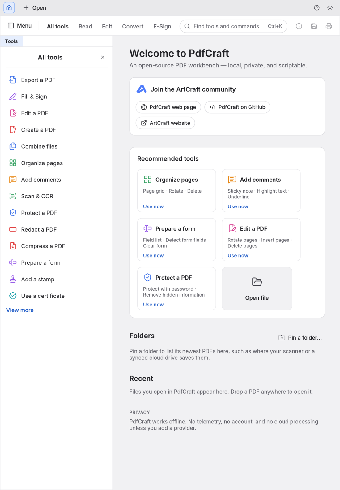

# PdfCraft for iPadOS (fork)

<p align="center">
  
  <br>
  <sub>PdfCraft on iPadOS, in portrait (iPad Air 11-inch simulator).</sub>
</p>

This fork exists only for the **iPadOS port** of PdfCraft, an open-source, clean-room PDF workbench
written in Rust. To learn about the project itself (features, file formats, desktop and web builds,
downloads, the other Crafting Apps, contributing), read the upstream README:
**[storytold/pdfcraft](https://github.com/storytold/pdfcraft#readme)**.

## What this fork adds

- **`apps/pdfcraft-ios`**: a Rust static-library runner (single UIKit window scene attached to winit's
  window, safe-area insets taken from UIKit every frame, settings in the app container). Open imports a
  copy of the PDF into the app container and remembers where it came from; Save reserves a file there, and
  a change tracker takes each saved document to the export picker the first time and to the remembered
  location after.
- **`vendor/rfd`**: rfd 0.17.2 with an iPadOS backend. PdfCraft opens its file pickers through
  `rfd::AsyncFileDialog`; on iOS every dialog goes to one handler the runner installs, which shows
  UIKit's document picker. The UI crate is unchanged, so merging upstream stays cheap.
- **`packaging/ios`**: the Xcode project that links the library into an iPad app bundle, with a bundle
  validator and tests. See its [README](packaging/ios/README.md).
- **`cargo xtask ios`**: build, install and launch on the Simulator or a physical iPad
  (`--sim`, `--device --device-id <id> --team <id> [--bundle-id <dev id>]`).
- **No Discord links.** The title-bar button, the Help command, the home screen entry and the strings in
  every language are gone.

## Status

Verified in the iPad Air 11-inch M3 simulator (iPadOS 26.2, 2026-10-13): the app builds, installs, launches
and draws the home screen in portrait inside the safe area.

**Not yet verified:** opening and saving a PDF through the Files picker, touch, Apple Pencil, an external
keyboard and its shortcuts, multitasking, landscape, Release builds, anything on a physical iPad. Not wired
up: choosing a folder (those dialogs are cancelled), printing, the system clipboard. This is a first
bootstrap, not a hardware sign-off.

## Build and run

Requires macOS with Xcode and the Rust targets `aarch64-apple-ios`, `aarch64-apple-ios-sim` and
`x86_64-apple-ios`.

```sh
cargo xtask ios --sim          # build, boot, install and launch on the iPad simulator
cargo xtask ios --device --device-id <udid> --team <team id> --bundle-id <your.dev.bundle.id>
cargo test -p pdfcraft-ios --lib
cargo test --manifest-path vendor/rfd/Cargo.toml --lib
python3 -m unittest discover -s packaging/ios/tests -v
```

Contributor rules (clean-room, never crash, layering, assets) are in [`AGENTS.md`](AGENTS.md).

## License and attribution

Dual-licensed MIT OR Apache-2.0, as upstream. Assets are listed in [`ATTRIBUTION.md`](ATTRIBUTION.md).
